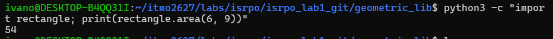
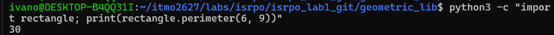
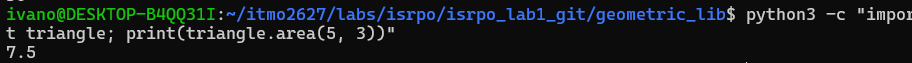
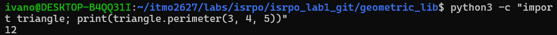
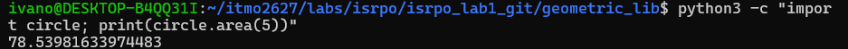
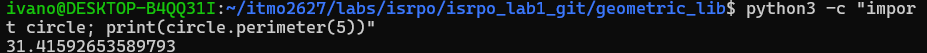
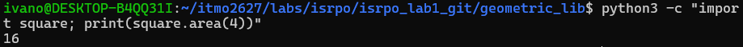
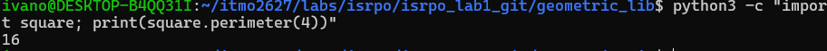

# Документация проекта Geometric Lib

## Общее описание решения
Библиотека `geometric_lib` предоставляет набор функций на языке Python для выполнения базовых геометрических вычислений. Проект позволяет рассчитывать площадь (`area`) и периметр / длину окружности (`perimeter`) для ключевых геометрических фигур:
* Прямоугольник (`rectangle.py`)
* Треугольник (`triangle.py`)
* Круг (`circle.py`)
* Квадрат (`square.py`)

---

## Описание функций с примерами вызова

### 1. Прямоугольник `rectangle.py`
* **`area(a, b)`** — вычисляет площадь прямоугольника по двум сторонам.
  * *Параметры*: `a` (число), `b` (число).
  * *Возвращает*: площадь `a * b`.
  * *Пример вызова*:
    ```python
    from rectangle import area
    print(area(6, 9))  # Вывод: 54
    ```
    

* **`perimeter(a, b)`** — вычисляет периметр прямоугольника.
  * *Параметры*: `a` (число), `b` (число)
  * *Возвращает*: периметр `(a + b) * 2`.
  * *Пример вызова*:
    ```python
    from rectangle import perimeter
    print(perimeter(6, 9))  # Вывод: 30
    ```
    

### 2. Треугольник `triangle.py`
* **`area(a, h)`** — вычисляет площадь треугольника по основанию и высоте.
  * *Параметры*: `a` (основание), `h` (высота).
  * *Возвращает*: площадь `a * h / 2`.
  * *Пример вызова*:
    ```python
    from triangle import area
    print(area(5, 3))  # Вывод: 7.5
    ```
    

* **`perimeter(a, b, c)`** — вычисляет периметр треугольника по трём сторонам.
  * *Параметры*: `a`, `b`, `c` (стороны).
  * *Возвращает*: периметр `a + b + c`
  * *Пример вызова*:
    ```python
    from triangle import perimeter
    print(perimeter(3, 4, 5))  # Вывод: 12
    ```
    

### 3. Круг `circle.py`
* **`area(r)`** — вычисляет площадь круга по радиусу.
  * *Параметры*: `r` (радиус).
  * *Возвращает*: площадь $\pi r^2$.
  * *Пример вызова*:
    ```python
    from circle import area
    print(area(5))  # Вывод: 78.53981633974483
    ```
    


* **`perimeter(r)`** — вычисляет длину окружности по радиусу.
  * *Параметры*: `r` (радиус).
  * *Возвращает*: длину окружности $2\pi r$.
  * *Пример вызова*:
    ```python
    from circle import perimeter
    print(perimeter(5))  # Вывод: 31.41592653589793
    ```
    

### 4. Квадрат (`square.py`)
* **`area(a)`** — вычисляет площадь квадрата по его стороне.
  * *Параметры*: `a` (сторона).
  * *Возвращает*: площадь `a * a`
  * *Пример вызова*:
    ```python
    from square import area
    print(area(4))  # Вывод: 16
    ```
    

* **`perimeter(a)`** — вычисляет периметр квадрата.
  * *Параметры*: `a` (сторона).
  * *Возвращает*: периметр `4 * a`.
  * *Пример вызова*:
    ```python
    from square import perimeter
    print(perimeter(4))  # Вывод: 16
    ```
    

---

## История изменений проекта
 |Хеш коммита | Пользователь | Изменения |
 | :--- | :--- | :--- |
 |bfb83ca | Ivan_Ovsyannikov | Исправлена ошибка в расчете периметра прямоугольника |
 |e825e1c | Ivan_Ovsyannikov | Добавлен файл `triangle.py` с функциями площади и периметра |
 |079281a | Ivan_Ovsyannikov | Добавлен файл `rectangle.py` с функциями прямоугольника |
 |d078c8d | smartiqa | Добавлена документация L-03 |
 |8ba9aeb | smartiqa | Добавлены `circle.py` и `square.py` |


### Заголовок 1
[Yandex](https://ya.ru)
Маркированный спосок 
1. Пункт 1
2. Пункт 2
3. Пункт 3
* punct 4
  * unpunct 5
<span style="color: red"> Этот текст красный </span>